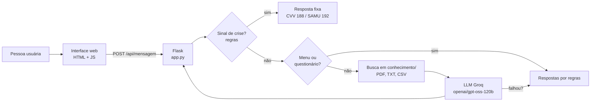

# 🌱 Acolhe Web

**Chatbot de primeiro acolhimento em saúde mental**, com triagem de sinais de esgotamento (burnout), ansiedade e humor, exercícios de respiração e orientação sobre onde buscar ajuda, incluindo uma base com os **CAPS do estado de São Paulo** (dados do CNES/DATASUS).


🔗 **Demonstração online:** https://acolhe-web.onrender.com/


> ⚠️ **Aviso importante:** o Acolhe é um projeto acadêmico. **Não faz diagnóstico, não prescreve tratamento e não substitui psicólogos, psiquiatras ou médicos.**
> Em sofrimento intenso, ligue para o **CVV 188** (24 h, gratuito) ou, em risco imediato, para o **SAMU 192**.

---

## ✨ Funcionalidades

- 💬 **Conversa livre e acolhedora**, gerada por LLM (Groq), com memória das últimas mensagens.
- 🚨 **Detecção de crise por regras**: frases de risco sempre recebem uma resposta fixa e segura, com CVV 188 e SAMU 192. Isso **nunca depende do LLM**.
- 📝 **Questionários de triagem** (humor, ansiedade e esgotamento) com pontuação e orientação.
- 🌬️ **Exercício de respiração guiada** e dicas de autocuidado.
- 📍 **Base de CAPS do estado de SP** (nome, endereço, telefone e horário), consultada por busca textual (RAG) para responder perguntas como *"endereço do CAPS Ipiranga"*.
- 🔒 **Sem banco de dados**: as conversas ficam só na memória do servidor e expiram após 1 hora de inatividade.
- 🛟 **Fallback**: se a API da Groq falhar ou não houver chave, o bot continua funcionando só com as respostas por regras.

## 🧠 Como funciona



Princípios de segurança do projeto:

1. **Regras primeiro**: crise, questionários e menu são determinísticos e testáveis.
2. **LLM só na conversa livre**, com prompt que proíbe diagnóstico e indicação de medicamentos.
3. **Sem inventar contatos**: endereços e telefones só saem dos documentos da pasta `conhecimento/`; se não houver o dado, o bot diz que não encontrou.

## 🗂️ Estrutura do projeto

```
Acolhe-Web/
├── app.py                 # servidor Flask (rotas /api/iniciar e /api/mensagem)
├── acolhe_bot.py          # motor do chatbot: crise, questionários, temas e integração com a Groq
├── conhecimento.py        # busca nos documentos (RAG leve, estilo BM25)
├── gerar_base_caps.py     # gera a lista de CAPS de SP a partir do CNES/DATASUS
├── conhecimento/          # documentos que o bot consulta (PDF, TXT, MD, CSV)
│   └── caps_estado_sp.txt
├── static/
│   └── index.html         # interface do chat
├── requirements.txt
├── Procfile               # comando de inicialização para hospedagem
└── .env.example           # modelo do arquivo de configuração
```

## 🚀 Como rodar no seu computador

**Pré-requisitos:** Python 3.12 (recomendado) e uma chave gratuita da [Groq](https://console.groq.com).

```bash
# 1. Baixe o projeto
git clone https://github.com/kaiqueoliveira327-cyber/Acolhe-Web.git
cd Acolhe-Web

# 2. Instale as dependências
python -m pip install -r requirements.txt

# 3. Configure a chave da Groq
#    Copie .env.example para .env e preencha:
#    GROQ_API_KEY=sua_chave_aqui

# 4. Inicie o servidor
python app.py
```

## 📍 Base de CAPS do estado de São Paulo

Os dados vêm do **CNES/DATASUS** (fonte oficial). Para gerar ou atualizar a lista:

```bash
python gerar_base_caps.py --teste   # confere a leitura em 3 CAPS
python gerar_base_caps.py           # gera a lista completa (alguns minutos)
python -m pip install reportlab     # opcional: gera também um PDF
```

Saídas: `conhecimento/caps_estado_sp.txt` (usado pelo bot), `caps_gerado/caps_estado_sp.csv` e `caps_gerado/caps_estado_sp.pdf`.
Você também pode colocar **qualquer PDF ou TXT** na pasta `conhecimento/` (cartilhas, listas de UBS etc.) e reiniciar o servidor.

## ☁️ Publicar na internet (Render)

1. Crie uma conta em [render.com](https://render.com) e clique em **New + → Web Service**.
2. Conecte este repositório.
3. Configure:
   - **Build Command:** `pip install -r requirements.txt`
   - **Start Command:** `gunicorn app:app --workers 1 --threads 4 --bind 0.0.0.0:$PORT`
4. Em **Environment Variables**, crie:
   - `GROQ_API_KEY` = sua chave (**só o nome, sem `=`**)
   - `PYTHON_VERSION` = `3.12.8`
5. Clique em **Create Web Service**. Ao final, acesse o link `.onrender.com` gerado.

> Use sempre **1 worker**: as conversas ficam na memória do processo. Com vários workers, a pessoa perderia o questionário no meio.

## 🔐 Privacidade e segurança (LGPD)

- O Acolhe **não grava** conversas em arquivo ou banco de dados; elas ficam na memória e expiram em 1 hora.
- Na **conversa livre**, o texto é enviado à API da Groq para gerar a resposta. Isso é informado no rodapé da página.
- A chave da API fica **somente** em variável de ambiente (`.env` local ou painel do Render) e **nunca** deve ir para o GitHub (o `.gitignore` já ignora o `.env`).
- Mensagens limitadas a 1000 caracteres e sessões antigas descartadas automaticamente.

## ⚠️ Limitações

- Um LLM pode errar ou responder de forma imprecisa, mesmo com as regras de segurança.
- A detecção de crise é feita por padrões de texto e **pode não reconhecer todas as formas de expressar sofrimento**.
- Os questionários são **triagens informativas**, não diagnósticos.
- Endereços e horários dos CAPS podem mudar: confirme por telefone antes de ir.

## 🛠️ Tecnologias

Python · Flask · Gunicorn · HTML/CSS/JavaScript · API da Groq (LLM) · pypdf · busca textual BM25 (implementação própria) · Render

## 📚 Fontes

- CNES/DATASUS: Cadastro Nacional de Estabelecimentos de Saúde ([cnes2.datasus.gov.br](http://cnes2.datasus.gov.br))
- CVV: Centro de Valorização da Vida, telefone 188
